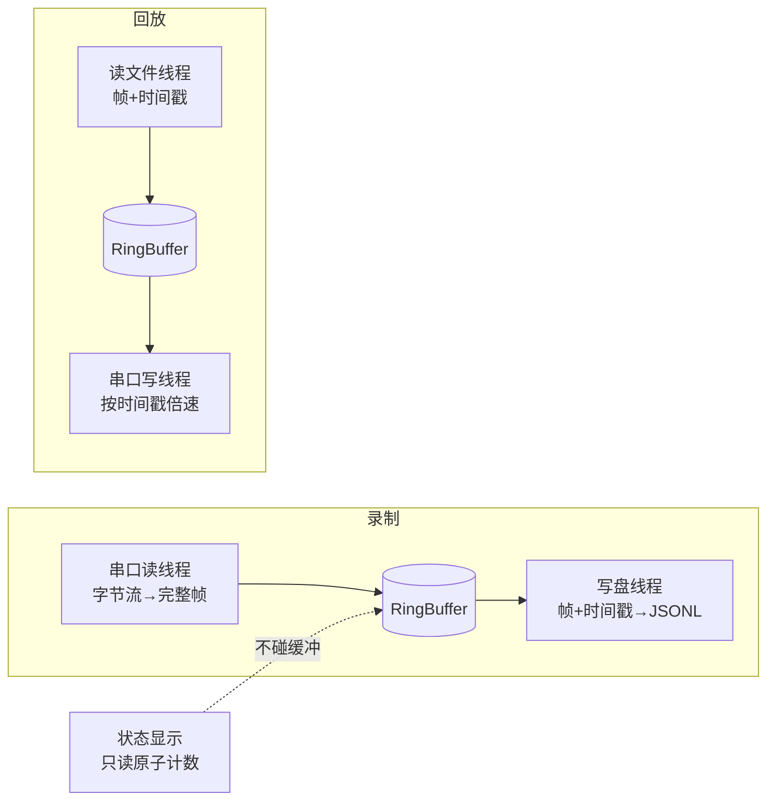

# serial_recorder · 串口数据录制 / 回放工具

> 机器人智驾作品集 #0 · C++17 · v0.1
> [](https://github.com/2932437988/learn/actions/workflows/serial-recorder-ci.yml)

从串口字节流中切出完整帧、加时间戳录制为 JSONL，并按原始时间间隔（可倍速）回放——一个可测试、可复现的命令行工具。

## 特性

- **逐字节状态机解码**：帧头 0xAA / 帧尾 0x55，正确处理粘包、半包、坏帧（丢弃并计数）
- **SPSC 有界阻塞环形缓冲**：读写线程解耦，满时背压不丢帧，关闭时唤醒并排空
- **按时间戳倍速回放**：`--speed 2` 两倍速，`sleep_until` 用绝对时刻避免累积漂移
- **可测试**：15 条 GTest 用例覆盖缓冲区四边界与回放时间轴，CTest + GitHub Actions CI
- **无内存泄漏**：valgrind 确认 `definitely lost: 0`

## 技术栈

C++17 · CMake · spdlog（落盘）· nlohmann-json（配置/解析）· GoogleTest · GitHub Actions · valgrind

## 编译

依赖（Ubuntu 22.04）：

```bash
sudo apt update
sudo apt install -y g++ cmake libspdlog-dev nlohmann-json3-dev libgtest-dev
```

## 构建与测试：

```bash
cmake -S . -B build -DCMAKE_BUILD_TYPE=Release -DBUILD_TESTING=ON
cmake --build build -j2
ctest --test-dir build --output-on-failure   # 预期 15/15 passed
```

## 用法

用随附脚本模拟串口字节流（无需硬件）：

```bash
# 录制：把模拟串口数据录成 JSONL
python3 tools/fake_serial.py | ./build/serial_recorder record --device - --out rec.jsonl

# 回放：按原时间戳写回串口（这里重定向到文件比对）
./build/serial_recorder play --in rec.jsonl --device - > playback.bin

# 验对称：源字节与回放字节一致
python3 tools/fake_serial.py > source.bin
cmp source.bin playback.bin && echo "1x 回放字节一致"

# 倍速：2 倍速回放耗时约为 1 倍速的一半
time ./build/serial_recorder play --in rec.jsonl --speed 2 --device - > /dev/null
```

真实串口把 `--device -` 换成 `/dev/ttyUSB0` 即可。

## 线程模型

录制与回放是两条方向相反的生产者—消费者流，缓冲是**唯一**的共享数据通道：



缓冲区四边界（详见 `docs/coverage.md`）：

| 边界 | 策略                  | 理由           |
| -- | ------------------- | ------------ |
| 空  | 条件变量阻塞等待            | 省 CPU，帧到自动唤醒 |
| 满  | 阻塞背压（不丢帧）           | 录制要求完整性      |
| 覆盖 | 不覆盖旧帧               | 覆盖等于静默丢帧     |
| 断连 | `close()` 唤醒 + 排空剩余 | 不挂死、不丢已收帧    |

## 目录结构

```text
CMakeLists.txt          构建与测试目标
include/serial_recorder 环形缓冲 / 帧 / 录制 / 回放 / CLI 头文件
src                     实现与 main.cpp
tests                   frame / ring_buffer / player 三组测试
tools                   fake_serial.py 模拟串口
docs                    coverage.md 测试覆盖清单
```

## 测试覆盖

15 条用例，详见 [docs/coverage.md](docs/coverage.md)。CI 在每次 push 后跑 build + ctest。

## 已知简化

- `--help` 当前返回码为 2（规范应为 0），不影响功能；
- 帧协议固定为帧头 0xAA / 帧尾 0x55，未做自动协商；
- 真实串口 termios 参数未做完整配置，示例用管道模拟。

## 版本

v0.1 — 首个可用版本（详见 git tag）。
